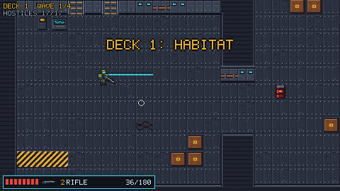
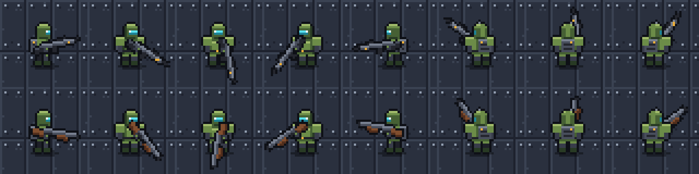
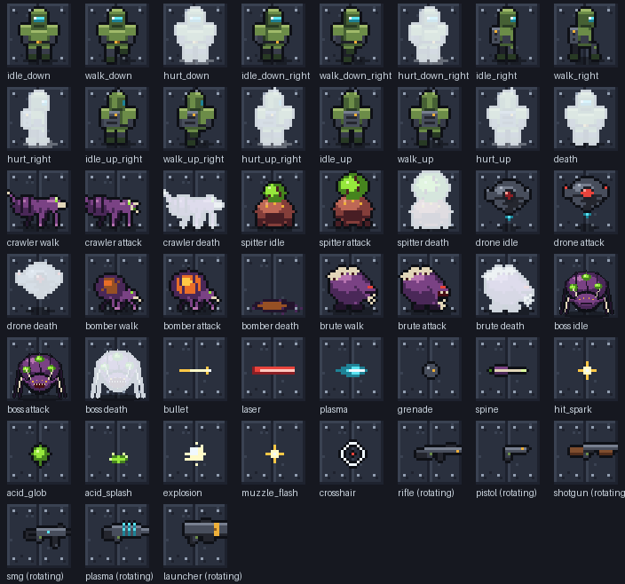

# Bulkhead Zero

A top-down sci-fi shooter made in Go with [Ebitengine](https://ebitengine.org).
A lone marine fights through an infested space station, deck by deck: survive the waves
pouring in through the doors, then take down the deck's boss.



*Recorded from the real game, played by the built-in autopilot.*

## Play

Needs Go 1.25+ (on macOS also the Xcode Command Line Tools: `xcode-select --install`).

```sh
go run .
```

| Action | Keys |
|---|---|
| Move | WASD or arrows |
| Aim / fire | Mouse / left button |
| Reload | R |
| Weapons | 1 pistol, 2 rifle, 3 shotgun, 4 smg, 5 plasma, 6 launcher; Q or wheel to cycle |
| Pause / fullscreen / mute | Esc or P / F / M |
| Restart | R in the pause menu, or R / click after dying or winning |

## How it plays

- **Two decks.** The Habitat, then the Reactor. Each is four waves and a boss: first clear
  the enemies already on the deck, then the next waves come in through the outer doors.
  Beating the boss takes you to the next deck; dying restarts the deck you're on.
- **Six guns.** You start with the pistol, rifle and shotgun; clearing waves unlocks the
  smg, the plasma rifle (its bolts pass through several enemies) and the grenade launcher
  (mind the blast). Every gun has a magazine and limited spare ammo, except the pistol.
- **Pickups.** Enemies sometimes drop medkits and ammo boxes. You also get some health back
  after each wave, and full health before a boss.
- **Enemies.** Crawlers rush you, spitters lob acid (watch the green marker where it will
  land), drones hover and shoot lasers, bombers run up and burst (shoot them early, ideally
  next to their friends), and brutes wind up and charge. Doors slide open for whoever walks
  up to them; red barrels explode.
- **Bosses.** The Brood Mother sprays rings of spines, lobs acid and summons her brood. The
  Warden, a security mech, keeps its distance, fires laser fans and mortar shells (orange
  markers show where they hit) and launches drones.

## Status

Playable prototype: two decks, five enemy types, two bosses, six weapons, generated music
and sound. `CLAUDE.md` has the design decisions, asset formats, code layout, tuning notes
and next steps.

| | |
|---|---|
|  |  |

## Art, sound and music

Every tile, sprite, font glyph, sound effect and music track is generated by the Python
scripts in `tools/artgen/` (no external assets, so no licensing to worry about). To
regenerate (about a minute, mostly the music):

```sh
pip3 install -r tools/artgen/requirements.txt
python3 tools/artgen/build.py
```

The Reactor map is laid out by `tools/maps/reactor.py`, which writes it into
`internal/world/maps.go`.

## Development

```sh
go test ./...                           # Linux without a display: xvfb-run go test ./...
go test ./internal/game -run Difficulty -v   # the bot plays 20 games per deck
```

Environment variables for testing and demos:

| Variable | Effect |
|---|---|
| `BZ_DECK=2` | start on that deck (e.g. to practise the Warden) |
| `BZ_AUTOPILOT=1` | a bot plays; `BZ_AUTOPILOT=human` gives it shaky aim and slow reactions |
| `BZ_RECORD=dir` | save every 3rd frame as PNG, quitting after `BZ_RECORD_SECONDS` (default 40) |
| `BZ_MUTE=1` | no audio |
