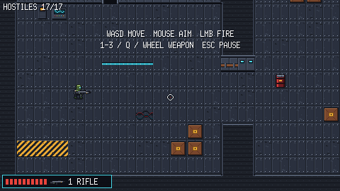
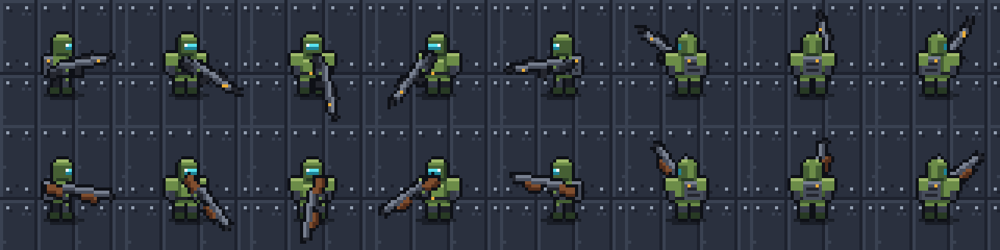
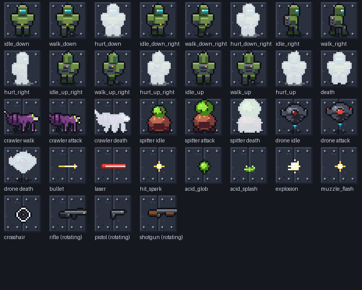

# Bulkhead Zero

A top-down sci-fi shooter made in Go with [Ebitengine](https://ebitengine.org).
Clear an infested space station: crawlers, acid-spitting mutants and sentry drones.
Move with WASD, aim with the mouse in any direction, swap between rifle, pistol and shotgun.



*Recorded from the real game, played by the built-in autopilot.*

## Play

Needs Go 1.22+ (on macOS also the Xcode Command Line Tools: `xcode-select --install`).

```sh
go run .
```

| Action | Keys |
|---|---|
| Move | WASD or arrows |
| Aim / fire | Mouse / left button |
| Weapons | 1 rifle, 2 shotgun, 3 pistol, Q or wheel to cycle |
| Pause / restart / fullscreen | Esc or P / R / F |

Clear all 17 hostiles on the deck. Shoot the red barrels when enemies are close.

## Status

Playable prototype: one level, three enemy types, three weapons. `CLAUDE.md` has the design
decisions, asset formats, code layout and next steps.

| | |
|---|---|
|  |  |

## Art

Every tile, sprite and effect is generated by the Python scripts in `tools/artgen/`
(no external assets, so no licensing to worry about). To regenerate:

```sh
pip3 install -r tools/artgen/requirements.txt
python3 tools/artgen/build.py
```

## Name

"Bulkhead Zero" had no matching game on Steam, itch.io, GOG or GitHub when it was chosen
(October 2026). Do a proper trademark search before any commercial release.
